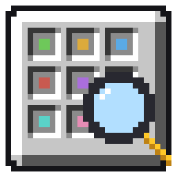
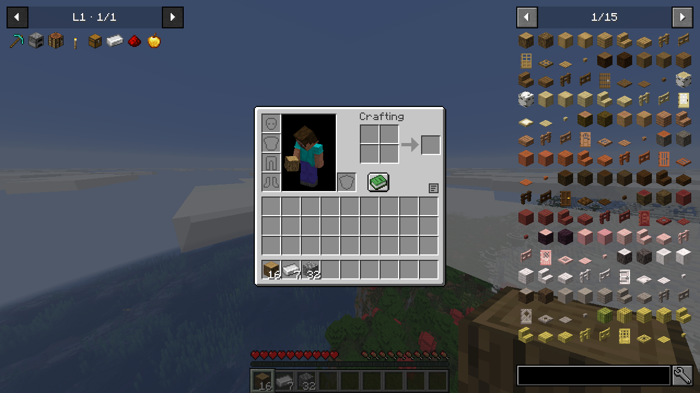
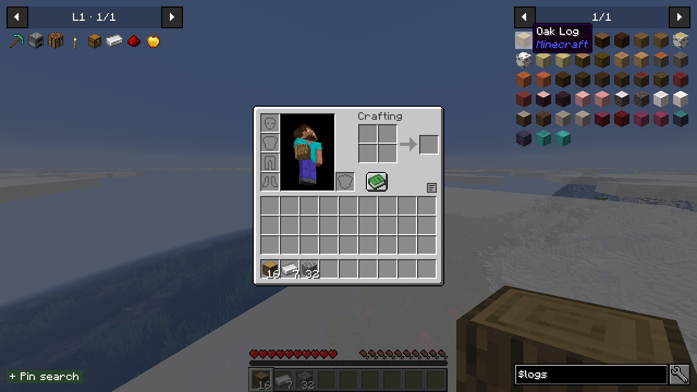
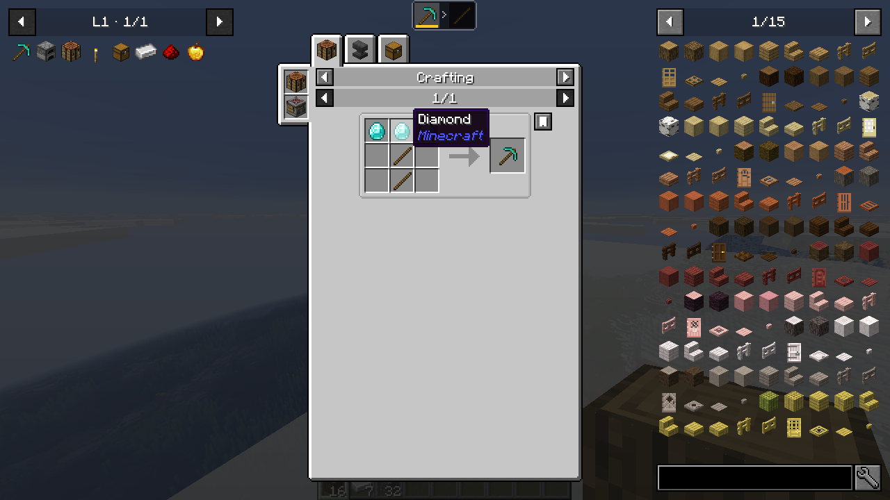
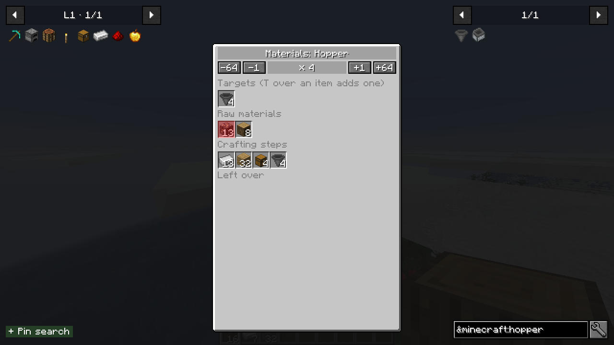
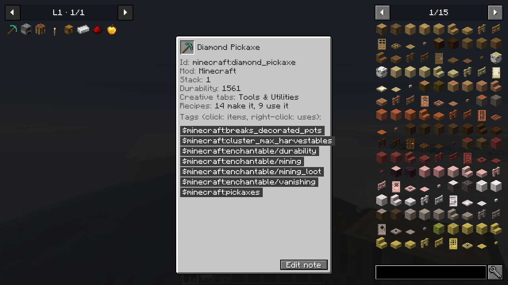
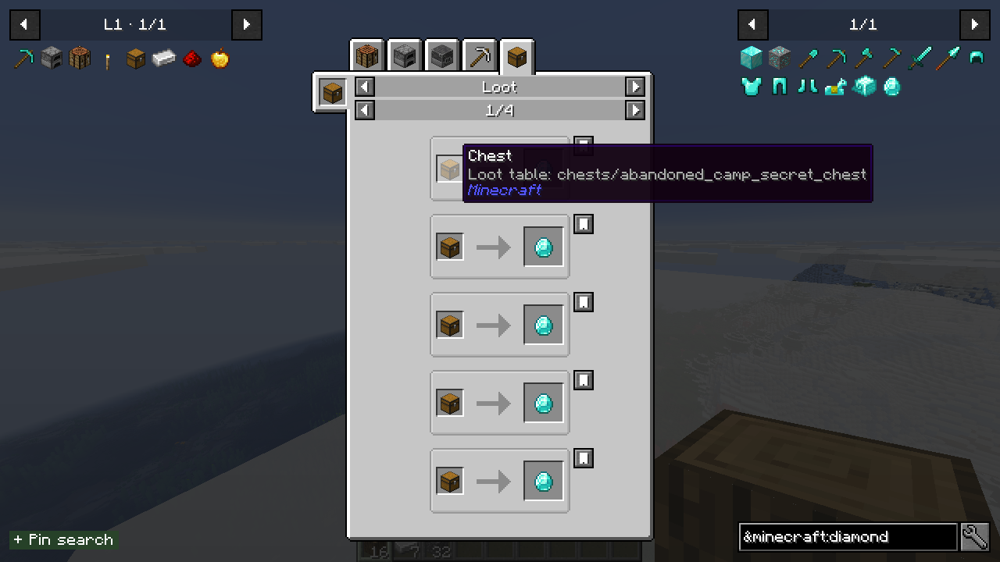

# All Enough Items

All Enough Items (AEI) is a client-side item and recipe browser for
[Horizon](https://github.com/horizon-rust/horizon), distributed through
Horizon's native mod system. It brings
[JEI](https://www.curseforge.com/minecraft/mc-mods/jei)'s layout and controls to
Horizon, and adds a material calculator, loot and fluid categories, notes,
collections and more.



- [Features](#features)
  - [Item list and search](#item-list-and-search)
  - [Recipes](#recipes)
  - [Bookmarks](#bookmarks)
  - [Beyond JEI](#beyond-jei)
- [Controls](#controls)
- [Options](#options)
- [Install](#install)
- [Develop and verify](#develop-and-verify)
- [Release](#release)
- [Structure](#structure)

## Features

### Item list and search

The item list is the creative inventory's, in its tab order, with every variant
it lists (enchanted books, potions, tipped arrows...), then any other registered
item. Water and lava follow the items as fluids, as JEI lists them.



Search with JEI's prefixes:

| Prefix | Searches | Example |
|---|---|---|
| none | names | `oak` |
| `@` | mods | `@minecraft` |
| `#` | tooltip lines | `#sharpness` |
| `$` | tags | `$logs` |
| `%` | creative tabs | `%food` |
| `&` | identifiers | `&minecraft:oak_log` |

Combine terms, quoted phrases, exclusions (`-`) and alternatives (`|`). The
settings page sets each prefix to *Enabled* (plain words search it too),
*Require prefix* or *Disabled*; tooltips and identifiers are searched by plain
words by default.

Beyond JEI:

- Plain words ignore accents (`maca` finds *Maçã*), also match the English name
  in another language, and forgive one typo in words of four letters or more
  (exact matches come first).
- Filters narrow the list:

  | Filter | Keeps |
  |---|---|
  | `is:food`, `is:block`, `is:enchantable`, `is:tool`, `is:stackable` | items of that kind |
  | `is:craftable` | what one recipe makes from the inventory in the open grid, updated as it changes |
  | `is:craftable2` | the same after one intermediate craft (planks first, then sticks) |
  | `is:locked` | what a recipe-book recipe you haven't unlocked makes |
  | `is:new` | items new to you (with the new-items option) |
  | `has:recipe`, `no:recipe` | items some recipe makes, or none does |
  | `rarity:epic` | items of that rarity |
  | `stack:1`, `dur>500`, `nutrition<4` | numbers compared with `<`, `>`, `=` or `:` |

- Between slashes a term is a regular expression, ignoring case: `/^oak/`,
  `&/_log$/`, or `"/^oak \w+s$/"` quoted for spaces. It supports `.`, classes,
  `\d \w \s`, anchors, groups, `|` and repeats.
- **Up** and **Down** in the search field recall earlier searches. A typed
  search can be pinned as a chip under the bookmarks with **+ Pin search**
  (eight at most): click a chip to search it again, right-click it to forget it.

The settings page orders the list by creative tabs (the default), mod or name,
limits its columns, can move the search bar under the screen, and has JEI's edit
mode: while it is on, clicking an entry hides it (Ctrl+click hides every stack
of that item); hidden entries show shaded red until edit mode is off, then leave
the list. The hidden list is saved.

### Recipes



- Hover any item and press **R** for its recipes or **U** for its uses: in the
  list, in a recipe, in any slot of any screen (the creative tabs' grid
  included) and over the vanilla recipe book's buttons. In the list, left-click
  shows recipes and right-click shows uses.
- Recipes open in a JEI-style window: category tabs above it, the crafting
  station on the left, category and page arrows, and recipes on bordered plates
  with animated furnace and brewing progress, cook time and experience.
- The category's catalysts (crafting table and crafter, both campfires...)
  stand in a column left of the window; click one for its recipes, right-click
  for its uses.
- Click ingredients to follow them. The last ten lookups line up above the tabs
  as a trail: the shown one lit, the ones after it dimmed, a blue corner on the
  lookups that show uses. Click one to go back to it.
- Ingredients with alternatives cycle every second; hold **Shift** to pause
  them. A slot whose alternatives are exactly a tag says so in its tooltip
  ("Accepts any: #minecraft:planks"), and with advanced tooltips (F3+H) an
  output shows its recipe id.
- Click **+** to move a recipe's ingredients into the open screen
  (**Shift-click** for as many sets as the inventory allows). Crafting recipes
  go through the vanilla recipe book into a grid they fit (2x2 in the
  inventory, 3x3 at a crafting table). Smelting, blasting and smoking recipes go
  into their furnace with ordinary container clicks: one item, or every stack of
  it with Shift. The button is orange when ingredients are missing (the grid
  shows a ghost recipe) and dark when the recipe isn't unlocked.
- Click the category title to browse every recipe, one tab per category.
  Categories follow the `categories` file in AEI's mod data folder
  (`horizon-mods/.horizon-mod-data/aei/`), written with every category on first
  use: move lines to reorder the tabs, or put `!` before one to hide it.
- A category tab's tooltip says how many of its recipe-book recipes you have
  unlocked and lists the first ones still locked.
- Categories: crafting, smelting, blasting, smoking, campfire, stonecutting,
  smithing, brewing, anvil, fuel and compostable, as JEI has them, and beyond
  JEI fluids, block drops, mob drops, loot and trading.

### Bookmarks

- Press **A** over any item (the list, a recipe, an inventory slot) to bookmark
  it, as in JEI. Bookmarks line up on the left of the screen with their own
  pages, open recipes and uses like the list, and are saved. Drag one onto
  another to reorder them.
- The ribbon button at the top right of each recipe bookmarks that recipe: its
  output joins the list with a gold corner and opens on that recipe.
- Beyond JEI, there are three bookmark lists (collections): click the bar's
  label to switch, right-click it to name the shown list, and press Ctrl+C or
  Ctrl+V over it to copy the list as text or replace it with one from the
  clipboard (plain item ids work too).

### Beyond JEI

**Material calculator.** Press **T** over an item: the raw materials a number of
it takes, the crafting steps in order and what is left over. It prefers
crafting, then cooking, never unpacks storage blocks, avoids loops, and counts
what the inventory holds first (short materials are red). **T** over another
item while it is open adds it to a shopping list; click a target to change its
count, right-click it to remove it; Shift+click a step to make it with its next
usable recipe. An option adds a **Next step** button that crafts the first
step the inventory allows through the recipe book, and another keeps the
shopping list on the HUD while you play.



**Item details.** Press **I** over an item for its id, mod, English name, stack
size, durability, food, rarity, creative tabs, recipe counts, components and
tags. Click a tag to list its items, or right-click it for the recipes that take
any of them. **Edit note** keeps a note on the item.



**Loot, drops and trades.** Read from the game's loot tables: Block Drops (what
breaking a block gives besides itself), Mob Drops (each mob as its spawn egg) and
Loot (chests, barrels, archaeology, fishing, bartering, shearing), one card per
item, with the table named in the slot tooltips. Every villager offer you see on
a trading screen joins a Trading category.



**Fluids.** A Fluids category shows water and lava at work: buckets and bottles
filled, concrete powder set, water meeting lava. Their icons use Horizon's single
per-game mod image, so another native mod drawing its own image would replace
them.

**More.**

- **P** over a recipe card pins it at the bottom left of the screen (two at
  most), kept in later sessions; P over it again unpins it.
- **Ctrl+C** over an item copies its id, **Ctrl+Shift+C** a `/give` command for
  that exact stack. Over a recipe card, Ctrl+C copies the recipe as Markdown and
  Ctrl+Shift+C saves the card as a PNG in AEI's folder
  (`horizon-mods/.horizon-mod-data/aei/recipes/<recipe id>.png`).
- **R** or **U** aimed at a block or an entity in the world (no screen open)
  opens the inventory on its item: an entity's pick-block item, such as a mob's
  spawn egg, whose uses are its drops.
- **Tab** puts a keyboard focus on the item list: the arrows move it across
  pages, Enter opens the focused item's recipes and AEI's keys act on it.
- With a controller, Horizon's inventory pointer hops between AEI's cells: A
  shows recipes, X uses, B goes back, the right stick turns pages, View bookmarks
  and the left stick click opens the calculator.
- With the game's narrator on, every item cell is read by name and count, and
  resting the pointer on a recipe card reads the whole recipe.
- For modpack makers, the settings page writes `report.md`: recipe counts by
  category, items no recipe makes or uses, conflicting crafting recipes, items no
  chain of recipes reaches and item tags no item fills.

## Controls

| Key | Over | Does |
|---|---|---|
| **R** / **U** | any item, or a block or entity in the world | recipes / uses |
| Left / right click | an item in the list | recipes / uses |
| **A** | any item | bookmark it |
| **T** | any item | material calculator (adds to the list while it is open) |
| **I** | any item | details panel |
| **P** | a recipe card | pin it beside the screen |
| **Ctrl+C** / **Ctrl+Shift+C** | an item | copy its id / a `/give` command |
| **Ctrl+C** / **Ctrl+Shift+C** | a recipe card | copy it as Markdown / save it as PNG |
| **Shift** | a recipe | pause the cycling ingredients |
| **Backspace**, **Left** / **Right** | recipes open | step back / back and forward in the lookup history |
| **Escape** or **E** | recipes open | close them, keeping the inventory open |
| **Ctrl+F** | the inventory | focus the search field |
| **Up** / **Down** | the search field | earlier searches |
| **Tab** | the inventory | keyboard focus on the item list |
| **Ctrl+O** | the inventory | hide or show the overlay (remembered) |
| Ctrl+click | the settings button | cheat mode |
| Right-click | the search field | clear it |

R, U, A, T, I and the back and forward keys can be rebound in Horizon's
controls.

## Options

The settings button (the wrench) opens AEI's page. Options that change the
vanilla look are off by default.

- **Cheat mode** tints the list red; clicking an item, bookmark or ingredient
  then gives it, a full stack with the left button and one with the right. In
  Creative the items go to the inventory (or to the cursor on the creative
  screen, if set); otherwise AEI sends `/give`, which the server only allows with
  permission. A stack dropped on the list on the creative screen is deleted.
- **Mod name in tooltips**, in blue italics as JEI does, and **recipe and use
  counts** in tooltips.
- **Spoiler-free mode** lists only items that have been in your inventory or
  that an unlocked recipe makes, and hides recipes you haven't unlocked (kept per
  world, or per server).
- **Mark newly found items** with a gold dot, including what newly unlocked
  recipes make; a "New (N)" chip lists them and right-clicking it marks them all
  as seen.
- **Search dims other inventory items** the typed search leaves out.
- **Group variants** folds an item's variants into one entry marked "+";
  Shift+click it to unfold them.
- **Recently viewed row** at the bottom left with the last nine lookups.
- **Dark theme**, **high contrast** and a **compact item list** with 16-px
  cells.
- **Shift over an item previews its recipe** next to the pointer.
- **Shopping list on the HUD**, and the calculator's **Next step** button.

## Install

In Horizon, select **Mods → Add from GitHub**, enter this repository URL and
install AEI (or run `horizon-launcher mods add-github <url> --trust-native-code`).
Horizon displays the native-code trust notice before building the instance.
Native mods run with the player's account permissions.

The launcher installs the latest release's `.hnmod` asset when there is one;
otherwise it builds the pinned commit from source. Both use the revisions in
`horizon-native.json`.

AEI's recipes, stack components, item rendering, fonts and translations come
from Horizon's native API. Recipe placement stays subject to the player's
learned recipes and the server's rules, and the vanilla recipe book is kept. The
graphics are drawing primitives, vanilla GUI sprites and the JEI-style sprites
Horizon ships; no JEI code or assets are included (see `docs/design.md`).

## Develop and verify

The repository is a Cargo workspace. Development commands live in the `xtask`
crate and run through Cargo:

```sh
cargo xtask check
horizon-mixins check --workspace /path/to/pinned/horizon \
  --mods /path/to/aei/mixins --out /path/to/aei-stage \
  --trust-native-mods --package horizon-client
```

`cargo xtask check` validates that the mod id, version and compatibility pins
agree across every manifest, that every file under `mixins/aei/` is one Horizon
keeps in a bundle, and that no packaged mod or JEI material is in the tree. It
then runs rustfmt over the workspace and the injected sources, Clippy and the
engine tests.

The second command compiles and tests the injected game in a scratch staging
directory, leaving the Horizon source unchanged. Use a clean git checkout of the
exact revision in `compatibility.json`, and put `--out` on a real disk rather
than a RAM-backed `/tmp`: the staged client's link step needs several
gigabytes. Keep game runs and packaged artifacts outside the source tree, with
fresh game directories and scratch homes as Horizon requires.

`cargo xtask install [--instance NAME] [--launcher PATH]` packages the working
tree into the instance's `horizon-native-mods/` (replacing other AEI bundles) and
runs `horizon-launcher native-build --trust-native-code` on it, so the next game
start plays the local source.

Recipe-window and item-list widgets label their stacks for automation as
`Item 3: minecraft:stone x1`; the control socket's widget id (`item-3`) stops at
the colon, so scripts keep stable ids and can still read what is shown.

For a disposable game already running with a control socket,
`cargo xtask ui-test /tmp/test-game/ctl.sock --out /tmp/aei-ui` exercises real
clicks, scrolling, categories, history, search, the calculator and the themes,
and saves screenshots outside the repository.

The native panel holds 256 recipes at a time, so longer categories are sent a
window at a time; the page numbers count the whole category.

## Release

1. Bump the version in `mixins/aei/engine/Cargo.toml`,
   `mixins/aei/horizon-mixin.toml` and `horizon-native.json`. When moving to a
   new Horizon revision, update the pins in `compatibility.json`,
   `horizon-native.json` and `[compatibility]` in `horizon-mixin.toml` together.
2. Run both verification commands above.
3. Run `cargo xtask package` to write a reproducible
   `dist/aei-<version>.hnmod` and its `.sha256` (`dist/` is ignored by git).
4. Attach the `.hnmod` to a GitHub release of the tagged commit.

## Structure

```text
Cargo.toml                  workspace: the engine and xtask
compatibility.json          Horizon, horizon-mixins and hook pins
horizon-native.json         native manifest Horizon reads from GitHub
mixins/aei/                 the bundle Horizon builds into the game
  horizon-mixin.toml        mod, pins, support modules and injections
  engine/                   aei-engine: Horizon-independent browser model
    src/browser.rs          event dispatch
    src/browser/            search, recipes, history, bookmarks, calculator,
                            loot and trades, discovery, report...
    src/viewer.rs           recipe geometry and pagination
    src/types.rs            browser models and actions
  modules/                  support modules injected into horizon-client
    runtime.rs              mod identity, key bindings, engine re-exports
    glue.rs                 native table lifecycle, conversion and actions
    centered_recipe_overlay.rs  recipe rendering and modal interaction
    recipe_paint.rs         panel, slot, arrow, button and theme drawing
    recipe_status.rs        recipe-book and furnace transfers
  hooks/                    one small helper per [[injection]]
xtask/                      cargo xtask check | install | package | ui-test
docs/design.md              structural decisions and their reasons
docs/images/                the screenshots above
```

The engine's `Cargo.toml` does not inherit workspace fields: Horizon copies the
crate out of this workspace when it builds the bundle.

AEI is MIT licensed; see [LICENSE](LICENSE).
